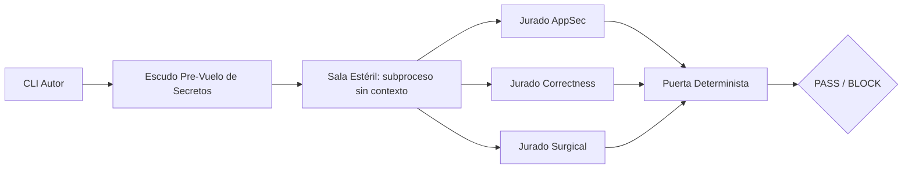

# cold-jury

Revisión de código cruzada entre CLIs. Cero dependencias. Puerta determinista.

## Por qué existe

Escribes código con un agente de IA. Le pides al mismo agente que lo revise antes de hacer commit. Pasa por alto fallos (errores lógicos, agujeros de seguridad, sobreingeniería) porque ya justificó esas decisiones durante la charla. Eso es *sycophancy*, autocomplacencia: el modelo está de acuerdo con su yo anterior.

cold-jury rompe ese bucle. Enruta tu `git diff` sin commitear a un **CLI distinto** (Codex, OpenCode, Gemini, Ollama, nunca el autor por defecto) que se ejecuta en una **sala estéril de contexto cero**. Tres jurados hostiles se ejecutan en paralelo: AppSec, Correctness, Surgical. Devuelven `PASS` o `BLOCK` con un veredicto JSON legible por máquina y un código de salida determinista.

La evidencia entre modelos es asimétrica. En las 116 tareas LiveCodeBench de arXiv:2607.21656, que Claude revise sus propios borradores no aportó nada (`91,4%` a `91,4%`), mientras que Claude revisando borradores de Codex subió la tasa de acierto del `71,6%` al `89,7%` (`+18,1 pp`, `p_BH = .001`). Por eso `claude` es el primer jurado por defecto cuando no es el autor.

## Arquitectura



1. **CLI Autor**: tu agente (Claude Code, Codex, OpenCode, Gemini, Ollama) produce un diff.
2. **Escudo Pre-Vuelo de Secretos**: escáner determinista local que redacta claves PEM, JWTs, credenciales de AWS, GitHub, GitLab, Slack, Sendgrid, npm, Stripe, webhooks y Google, asignaciones de entorno y credenciales dentro de URIs, tanto en el diff como en `--spec`. Si acierta un patrón P0 emite `P0 SECRET_LEAK` y ningún jurado llega a correr.
3. **Sala Estéril**: un subproceso efímero por jurado, en su propio directorio temporal y con un entorno de lista blanca. Sin historial de chat, sin memoria de sesión y sin secretos de tu shell.
4. **Tres Jurados Hostiles, en paralelo**:
   - `appsec`: inyección, SSRF, path traversal, bypass de auth y sesión, secretos (taxonomía CWE)
   - `correctness`: regresiones, condiciones de carrera, manejo de errores roto, casos límite nulos y vacíos
   - `surgical`: disciplina YAGNI, código muerto, abstracciones prematuras, cambios fuera de la spec
5. **Puerta Determinista**: agrega los veredictos JSON. Código de salida `0` = `PASS`, `1` = `BLOCK` (cualquier hallazgo en o por encima de `--fail-on`, por defecto `P1`), `2` = error de uso o de ejecución de motores. Tabla legible por defecto, `--json` para CI y hooks.

El diff y la spec revisados van en vallas con un nonce por ejecución y un contrato anti-inyección, y el veredicto se lee solo del canal oficial del asistente, nunca de la entrada replicada.

## Instalación

```bash
# Directo desde GitHub, sin depender del registro npm
npx --yes github:Dimoncelli/cold-jury doctor
npx --yes github:Dimoncelli/cold-jury review --author hook --spec "Añadir clave de idempotencia al endpoint de pagos"

# Como Skill (Claude Code, Codex, OpenCode)
npx skills add Dimoncelli/cold-jury

# Dentro de la carpeta del skill se prefiere el binario empaquetado
node <skill-dir>/bin/cold-jury.mjs doctor
```

Requiere Node.js `>=20` y al menos un motor en `PATH`. Cero dependencias npm. Se usa `npx --yes github:<owner>/<repo>` a propósito: así nunca se resuelve un paquete `cold-jury` de npm que un tercero pueda haber registrado.

## Inicio rápido

```bash
# 1. Haz cambios y déjalos en el índice
git add -A

# 2. Ejecuta cold-jury desde la raíz del repo
npx --yes github:Dimoncelli/cold-jury review --author hook --spec "Qué hace este cambio en una frase"

# 3. Lee el veredicto
# PASS  -> puerta limpia, seguro para commitear (salida 0)
# BLOCK -> cada hallazgo con archivo:línea, corrige y repite (salida 1)
```

`--spec` es opcional pero recomendable: es el contrato atómico contra el que el jurado surgical mide el alcance. Un diff vacío corta el proceso con `PASS` y cero jurados lanzados.

## Ejemplo de salida en terminal

```
$ npx --yes github:Dimoncelli/cold-jury review --spec "Añadir lógica de reintento al manejador de webhooks"

cold-jury 0.1.0 | author claude | jurors codex,opencode,ollama
SECRET SHIELD: CLEAN (0 redactions)

JUROR        PROBE         LEVEL  LOCATION                FINDING
------------------------------------------------------------------------
codex        appsec        P1     src/webhook.ts:42       Missing signature check
opencode     correctness   P2     src/retry.ts:18         No retry cap on 5xx
ollama       surgical      P2     src/retry.ts:3          Unrequested abstraction

VERDICT: BLOCK (exit 1) | P0 0 | P1 1 | P2 2
```

Los colores respetan `NO_COLOR`, el flag `--no-color` y si stdout es una TTY, así que los logs redirigidos y la CI no reciben códigos de escape. Las rutas largas se truncan por la izquierda para conservar el nombre del archivo y la línea.

Añade `--output .cold-jury/verdict.json` para guardar ese mismo JSON en disco, y `--json` para imprimirlo en stdout en lugar de la tabla.

## Referencia CLI

| Comando | Qué hace |
|---------|----------|
| `cold-jury doctor` | Detecta los motores en `PATH` e imprime `READY`, `OFFLINE` (binario presente, daemon apagado) o `NOT_FOUND`. También existe como `cold-jury --doctor`. |
| `cold-jury review [flags]` | Ejecuta la sala estéril: escudo, diff, jurados y veredicto agregado. |
| `cold-jury install-hook [--type pre-commit\|pre-push] [--force]` | Instala un hook idempotente. El de pre-push lee de stdin las referencias empujadas y revisa el rango real. |
| `cold-jury --version`, `-v` | Imprime `cold-jury <versión>` y sale con `0`. |
| `cold-jury --help`, `-h` | Imprime la lista completa de flags y sale con `0`. |

### Flags de `review`

| Flag | Por defecto | Descripción |
|------|-------------|-------------|
| `--staged` | activo | Revisa `git diff --cached`. |
| `--range <rev>` | inactivo | Revisa `git diff <rev> --`. Las revisiones que empiezan por `-` o llevan caracteres inseguros se rechazan (CWE-88). |
| `--spec <texto\|archivo>` | ninguno | Intención atómica del cambio, texto inline o ruta a un `.md` / `.txt` dentro del repositorio. Se redacta y se limita a 20000 bytes. |
| `--author <engine>` | auto | Motor autor: `claude`, `codex`, `gemini`, `opencode`, `ollama`, o los autores neutrales `hook` y `ci`. Se autodetecta desde `CLAUDECODE`, `CLAUDE_CODE_ENTRYPOINT`, `CODEX_CLI`, `GEMINI_CLI` u `OPENCODE_*`. |
| `--jurors <lista>` | todos los READY menos el autor | Motores separados por comas, se usan los tres primeros, `claude` primero cuando no es el autor. |
| `--probes <lista>` | `appsec,correctness,surgical` | Qué sondas hostiles se ejecutan. |
| `--json` | inactivo | Imprime solo el veredicto JSON agregado en stdout. |
| `--fail-on <P0\|P1\|P2>` | `P1` | Umbral de bloqueo. `P0` bloquea solo con P0, `P1` con P0 y P1, `P2` con los tres. |
| `--allow-same-engine` | inactivo | Permite que el motor autor juzgue. La regla Autor distinto de Jurado sigue activa por defecto. |
| `--timeout <ms>` | `120000` | Timeout por jurado, se mata con `SIGKILL` y `taskkill /T` en Windows al vencer. |
| `--max-bytes <bytes>` | `300000` | Tope del diff. Los diffs mayores se truncan en un salto de línea y quedan marcados en el veredicto. |
| `--output <ruta>` | ninguna | Escribe el JSON del veredicto en una ruta `.json` dentro del repositorio. Los symlinks se rechazan. |
| `--no-color` | auto | Desactiva los colores ANSI. |

### Códigos de salida

| Código | Significado |
|--------|-------------|
| `0` | `PASS`: ningún hallazgo en o por encima del umbral. |
| `1` | `BLOCK`: al menos un hallazgo en o por encima del umbral, o un `P0 SECRET_LEAK`. |
| `2` | Error de uso o configuración, o `engine_execution_failed` cuando ningún jurado completó una sonda. |

## Integración CI (GitHub Actions)

```yaml
# .github/workflows/cold-jury.yml
name: Cold Jury Gate
on: [pull_request]
jobs:
  review:
    runs-on: ubuntu-latest
    steps:
      - uses: actions/checkout@v4
        with:
          fetch-depth: 0
      - uses: actions/setup-node@v4
        with:
          node-version: '20'
      - name: Revisar el rango del pull request
        env:
          PR_TITLE: ${{ github.event.pull_request.title }}
          BASE_REF: ${{ github.base_ref }}
        run: |
          npx --yes github:Dimoncelli/cold-jury review \
            --author ci \
            --range "origin/$BASE_REF...HEAD" \
            --spec "$PR_TITLE" \
            --json
```

El workflow nunca interpola `${{ ... }}` dentro de `run:`. Los valores no confiables llegan al comando por `env:` y variables de shell entrecomilladas.

## Manifiestos de skill y plugin

| Host | Archivo |
|------|---------|
| Claude Code, Codex, OpenCode | `SKILL.md` (frontmatter AAIF, versión dentro de `metadata`) |
| Agentes de Codex | `agents/openai.yaml` (incluye el bloque `interface`) |
| Plugin de Claude Code | `.claude-plugin/plugin.json` y `.claude-plugin/marketplace.json` |

## Modelo de seguridad

- Solo `spawn`, siempre con array de argumentos y `shell: false`. Sin `exec`, sin `execFile`, sin cadenas de shell.
- El prompt y el diff viajan por `stdin`, o por un fichero `0600` dentro de la sala estéril para `opencode`, nunca por `argv`.
- Cada jurado recibe un entorno de lista blanca: lo básico del sistema más `NO_COLOR` y solo las variables de su motor. Nada más de `process.env` entra en la sala.
- La resolución en Windows prefiere la entrada real de los shims de npm, no sale del directorio del shim y nunca entrega a `cmd.exe` una ruta con `"`, `%`, `!` o `^` (clase CVE-2024-27980).
- Cada jurado corre en un directorio temporal nuevo, borrado con `fs.rmSync(dir, { recursive: true, force: true })` en un bloque `finally`.
- La salida de los jurados se redacta y se limpia de caracteres de control antes de pintarse. Los fallos de motor van a `errors`, no a hallazgos inventados.
- Las rutas de salida del veredicto y los hooks quedan confinados al repositorio y rechazan symlinks.

## Comparación honesta

| Característica | cold-jury | claude-code-cross-review | Prompt de revisión manual |
|----------------|-----------|--------------------------|---------------------------|
| Autor distinto de Jurado forzado | ✓ | — | — |
| Soporte multi-CLI | ✓ | ✓ | ✓ |
| Sala estéril de contexto cero | ✓ | — | — |
| Redacción pre-vuelo de secretos | ✓ | — | — |
| Tres jurados ortogonales en paralelo | ✓ | — | — |
| Puerta PASS/BLOCK determinista | ✓ | — | — |
| Cero dependencias npm | ✓ | — | ✓ |
| Windows, macOS y Linux | ✓ | ✓ | ✓ |
| Paquete Skill (AAIF) | ✓ | ✓ | — |
| Veredicto JSON listo para CI | ✓ | — | — |

## Licencia

MIT. Autor: Dimoncelli.
