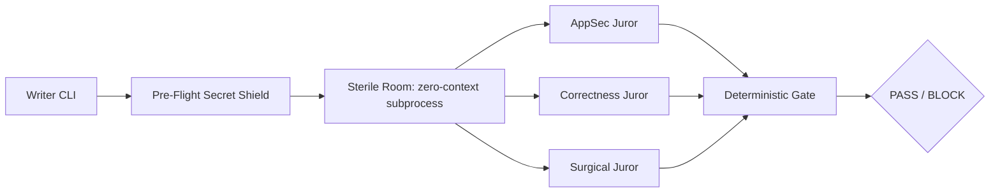

# cold-jury

Cross-CLI hostile code review. Zero dependencies. Deterministic gate.

## Why this exists

You write code with an AI agent. You ask the same agent to review it before you commit. It misses things (logic errors, security holes, over-engineering) because it already justified those decisions during the chat. This is *sycophancy*: the model agrees with its past self.

cold-jury breaks that loop. It routes your uncommitted `git diff` to a **different CLI** (Codex, OpenCode, Gemini, Ollama, never the author by default) running in a **sterile, zero-context room**. Three hostile jurors run in parallel: AppSec, Correctness, Surgical. They return `PASS` or `BLOCK` with a machine-readable JSON verdict and a deterministic exit code.

The cross-model evidence is not symmetric. In the 116 LiveCodeBench tasks from arXiv:2607.21656, Claude reviewing its own drafts added nothing (`91.4%` to `91.4%`), while Claude reviewing Codex drafts moved the pass rate from `71.6%` to `89.7%` (`+18.1 pp`, `p_BH = .001`). That is why `claude` is the first default juror whenever it is not the author.

## Architecture



1. **Writer CLI**: your agent (Claude Code, Codex, OpenCode, Gemini, Ollama) produces a diff.
2. **Pre-Flight Secret Shield**: local deterministic scanner redacts PEM keys, JWTs, AWS, GitHub, GitLab, Slack, Sendgrid, npm, Stripe, webhook and Google credentials, environment assignments and credentials inside URIs, both in the diff and in `--spec`. A P0 match emits `P0 SECRET_LEAK` and no juror runs.
3. **Sterile Room**: one ephemeral subprocess per juror, in its own temporary directory, with a whitelisted environment. No chat history, no session memory, no secrets from your shell.
4. **Three Hostile Jurors, in parallel**:
   - `appsec`: injection, SSRF, path traversal, auth and session bypass, secrets (CWE taxonomy)
   - `correctness`: regressions, race conditions, broken error handling, null and empty edge cases
   - `surgical`: YAGNI discipline, dead code, premature abstractions, changes outside the spec
5. **Deterministic Gate**: aggregates the JSON verdicts. Exit code `0` = `PASS`, `1` = `BLOCK` (any finding at or above `--fail-on`, default `P1`), `2` = usage or engine execution failure. Human table by default, `--json` for CI and hooks.

The reviewed diff and spec are fenced with a per-run nonce and an anti-injection contract, and the verdict is read only from the engine's official assistant channel, never from echoed input.

## Installation

```bash
# Straight from GitHub, no npm registry needed
npx --yes github:Dimoncelli/cold-jury doctor
npx --yes github:Dimoncelli/cold-jury review --author hook --spec "Add idempotency key to payment endpoint"

# As a Skill (Claude Code, Codex, OpenCode)
npx skills add Dimoncelli/cold-jury

# Inside the skill folder, the bundled binary is preferred
node <skill-dir>/bin/cold-jury.mjs doctor
```

Requires Node.js `>=20` and at least one engine in `PATH`. Zero npm dependencies. `npx --yes github:<owner>/<repo>` is used on purpose: it never resolves a possibly squatted `cold-jury` package from npm.

## Quick start

```bash
# 1. Make some changes and stage them
git add -A

# 2. Run cold-jury from the repo root
npx --yes github:Dimoncelli/cold-jury review --author hook --spec "What this change does in one sentence"

# 3. Read the verdict
# PASS  -> clean gate, safe to commit (exit 0)
# BLOCK -> every finding with file:line, fix and re-run (exit 1)
```

`--spec` is optional but recommended: it is the atomic contract the surgical juror checks scope against. An empty diff short-circuits to `PASS` with zero jurors spawned.

## Terminal output example

```
$ npx --yes github:Dimoncelli/cold-jury review --spec "Add retry logic to webhook handler"

cold-jury 0.1.0 | author claude | jurors codex,opencode,ollama
SECRET SHIELD: CLEAN (0 redactions)

JUROR        PROBE         LEVEL  LOCATION                FINDING
------------------------------------------------------------------------
codex        appsec        P1     src/webhook.ts:42       Missing signature check
opencode     correctness   P2     src/retry.ts:18         No retry cap on 5xx
ollama       surgical      P2     src/retry.ts:3          Unrequested abstraction

VERDICT: BLOCK (exit 1) | P0 0 | P1 1 | P2 2
```

Colors follow `NO_COLOR`, the `--no-color` flag and whether stdout is a TTY, so redirected logs and CI stay free of escape codes. Long paths are truncated from the left, so the file name and line number survive.

Add `--output .cold-jury/verdict.json` to keep the same JSON on disk, and `--json` to print it to stdout instead of the table.

## CLI reference

| Command | What it does |
|---------|--------------|
| `cold-jury doctor` | Detects the review engines in `PATH` and prints `READY`, `OFFLINE` (binary present, daemon down) or `NOT_FOUND`. Also available as `cold-jury --doctor`. |
| `cold-jury review [flags]` | Runs the sterile room: secret shield, diff, jurors, aggregated verdict. |
| `cold-jury install-hook [--type pre-commit\|pre-push] [--force]` | Installs an idempotent hook. The pre-push hook reads the pushed refs from stdin and reviews the real range. |
| `cold-jury --version`, `-v` | Prints `cold-jury <version>` and exits `0`. |
| `cold-jury --help`, `-h` | Prints the full flag list and exits `0`. |

### `review` flags

| Flag | Default | Description |
|------|---------|-------------|
| `--staged` | on | Reviews `git diff --cached`. |
| `--range <rev>` | off | Reviews `git diff <rev> --`. Revisions starting with `-` or carrying unsafe characters are rejected (CWE-88). |
| `--spec <text\|file>` | none | Atomic intent of the change, inline text or a `.md` / `.txt` path inside the repository. Redacted and capped at 20000 bytes. |
| `--author <engine>` | auto | Authoring engine: `claude`, `codex`, `gemini`, `opencode`, `ollama`, or the neutral authors `hook` and `ci`. Auto-detected from `CLAUDECODE`, `CLAUDE_CODE_ENTRYPOINT`, `CODEX_CLI`, `GEMINI_CLI` or `OPENCODE_*`. |
| `--jurors <list>` | every READY engine except the author | Comma separated engines, first three used, `claude` first when it is not the author. |
| `--probes <list>` | `appsec,correctness,surgical` | Which hostile probes run. |
| `--json` | off | Prints only the aggregated JSON verdict to stdout. |
| `--fail-on <P0\|P1\|P2>` | `P1` | Blocking threshold. `P0` blocks only on P0, `P1` on P0 and P1, `P2` on all three. |
| `--allow-same-engine` | off | Lets the author engine judge. Writer != Juror stays enforced by default. |
| `--timeout <ms>` | `120000` | Per juror timeout, killed with `SIGKILL` and `taskkill /T` on Windows when it expires. |
| `--max-bytes <bytes>` | `300000` | Diff cap. Larger diffs are truncated at a line break and flagged in the verdict. |
| `--output <path>` | none | Writes the verdict JSON to a `.json` path inside the repository. Symlinks are refused. |
| `--no-color` | auto | Disables ANSI colors. |

### Exit codes

| Code | Meaning |
|------|---------|
| `0` | `PASS`: no finding at or above the threshold. |
| `1` | `BLOCK`: at least one finding at or above the threshold, or a `P0 SECRET_LEAK`. |
| `2` | Usage or configuration error, or `engine_execution_failed` when no juror completed a probe. |

## CI integration (GitHub Actions)

```yaml
# .github/workflows/cold-jury.yml
name: Cold Jury Gate
on: [pull_request]
jobs:
  review:
    runs-on: ubuntu-latest
    steps:
      - uses: actions/checkout@v4
        with:
          fetch-depth: 0
      - uses: actions/setup-node@v4
        with:
          node-version: '20'
      - name: Review the pull request range
        env:
          PR_TITLE: ${{ github.event.pull_request.title }}
          BASE_REF: ${{ github.base_ref }}
        run: |
          npx --yes github:Dimoncelli/cold-jury review \
            --author ci \
            --range "origin/$BASE_REF...HEAD" \
            --spec "$PR_TITLE" \
            --json
```

The workflow never interpolates `${{ ... }}` inside `run:`. Untrusted values reach the command through `env:` and quoted shell variables.

## Skill and plugin manifests

| Host | File |
|------|------|
| Claude Code, Codex, OpenCode | `SKILL.md` (AAIF frontmatter, version under `metadata`) |
| Codex agents | `agents/openai.yaml` (includes the `interface` block) |
| Claude Code plugin | `.claude-plugin/plugin.json` and `.claude-plugin/marketplace.json` |

## Security model

- `spawn` only, always with an argv array and `shell: false`. No `exec`, no `execFile`, no shell strings.
- The prompt and the diff travel on `stdin`, or on a `0600` file inside the sterile room for `opencode`, never in `argv`.
- Each juror gets a whitelisted environment: OS basics plus `NO_COLOR` and only the variables owned by that engine. Nothing else from `process.env` leaks in.
- Windows resolution prefers the real entry of npm shims, stays inside the shim directory and never hands a path containing `"`, `%`, `!` or `^` to `cmd.exe` (CVE-2024-27980 class).
- Every juror runs in a fresh temporary directory, removed with `fs.rmSync(dir, { recursive: true, force: true })` in a `finally` block.
- Juror output is redacted and stripped of control characters before rendering. Engine failures go to `errors`, not to fake code findings.
- Verdict output paths and hooks are confined to the repository and refuse symlinks.

## Honest comparison

| Feature | cold-jury | claude-code-cross-review | Manual review prompt |
|---------|-----------|--------------------------|----------------------|
| Writer not equal to Juror enforced | ✓ | — | — |
| Multi-CLI support | ✓ | ✓ | ✓ |
| Zero-context sterile room | ✓ | — | — |
| Pre-flight secret redaction | ✓ | — | — |
| Three orthogonal jurors in parallel | ✓ | — | — |
| Deterministic PASS/BLOCK gate | ✓ | — | — |
| Zero npm dependencies | ✓ | — | ✓ |
| Windows, macOS and Linux | ✓ | ✓ | ✓ |
| Skill package (AAIF) | ✓ | ✓ | — |
| CI-ready JSON verdict | ✓ | — | — |

## License

MIT. Author: Dimoncelli.
